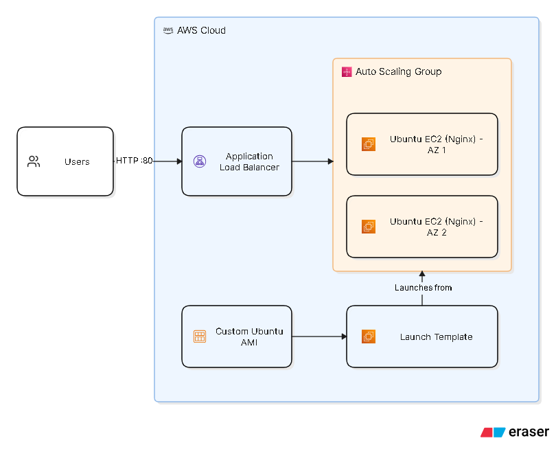
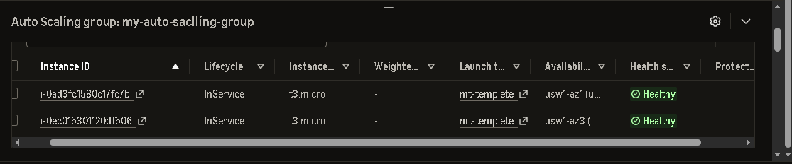
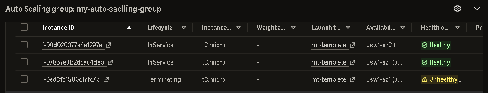

# High-Availability Auto-Scaling Nginx Web Server on AWS

## Overview
This project demonstrates a fault-tolerant, self-healing web server architecture on AWS. Incoming HTTP traffic is distributed across multiple Ubuntu EC2 instances running Nginx, managed automatically by an Application Load Balancer and an Auto Scaling Group across multiple Availability Zones.

## Architecture

### AWS Services Used
* **Amazon EC2 & User Data:** Bootstrapped an Ubuntu Server instance using [`scripts/user-data.sh`](scripts/user-data.sh) to update packages and install Nginx automatically on boot.
* **Custom AMI & Launch Template:** Captured the configured Ubuntu EC2 instance as an Amazon Machine Image (AMI) and created a Launch Template for consistent, rapid scaling.
* **Application Load Balancer (ALB) & Target Group:** Distributed incoming HTTP (Port 80) traffic across multiple Availability Zones and monitored target health.
* **Auto Scaling Group (ASG):** Maintained desired instance capacity across Availability Zones and automatically replaced unhealthy or terminated instances.

## Deployment Workflow
1. **Base Server & Nginx Setup:** Launched an Ubuntu EC2 instance with a User Data script to install and start Nginx on Port 80.
2. **Golden Image & Template:** Created a Custom AMI from the configured Ubuntu instance and attached it to an EC2 Launch Template.
3. **Load Balancing:** Configured an internet-facing Application Load Balancer across two Availability Zones routing HTTP (Port 80) traffic to an EC2 Target Group.
4. **Auto Scaling & Self-Healing:** Attached an Auto Scaling Group to the Target Group to maintain instance health and automatically launch replacement instances when an instance becomes unhealthy.

## Proof of Work

### 1. Auto Scaling Group Configuration

### 2. Self-Healing: Auto Scaling Handling Unhealthy Instance

### 3. EC2 Instance Provisioned by Auto Scaling
(images/EC2-created-by-auto-scaling.png)

### 4. Application Load Balancer Configuration
(images/application-load-balancer.png)

## Cost Management & Cleanup
After verifying and documenting the deployment, all AWS resources were deleted in the following order to prevent ongoing charges:
1. **Auto Scaling Group** (automatically terminates managed EC2 instances)
2. **Application Load Balancer & Target Group**
3. **Custom AMI** (deregistered) & associated **EBS Snapshots** (deleted)
